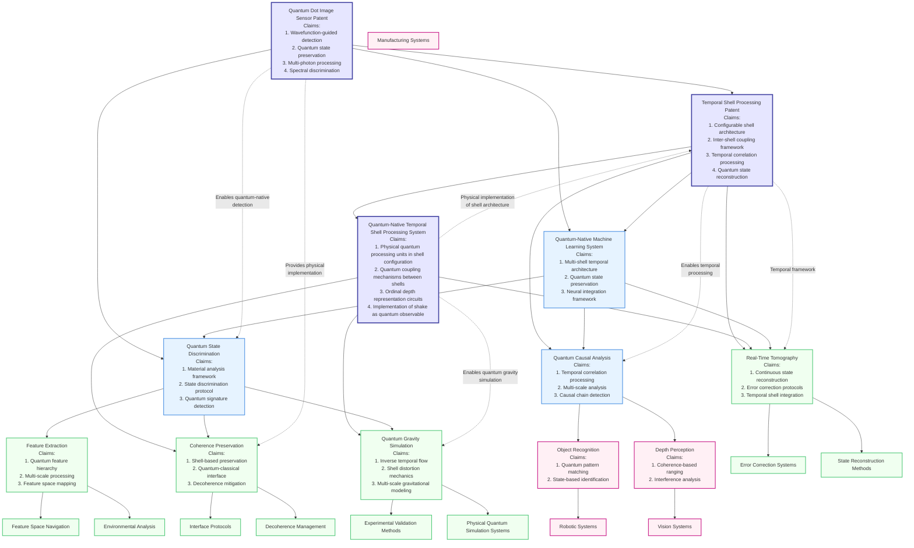

Let me formulate a comprehensive set of patent applications based on the quantum-native machine perception framework:

1. Title: "System and Method for Quantum-Native Machine Learning Through Multi-Shell Temporal Processing"
Abstract: A system implementing quantum-native neural networks that directly process quantum states through a multi-shell temporal architecture. The invention enables direct learning from quantum mechanical features without collapsing to classical representations.

2. Title: "Quantum State Discrimination System for Robotic Material Analysis"
Abstract: A system for real-time quantum mechanical analysis of materials using photon quantum state discrimination. The invention enables robots to directly sense quantum-level material properties through temporal shell processing of quantum signatures.

3. Title: "Method for Quantum Causal Analysis in Machine Perception Systems"
Abstract: A method for analyzing quantum causal relationships across multiple temporal scales using a shell-based processing architecture, enabling machines to understand temporal relationships at the quantum level.

4. Title: "Quantum-Enhanced Predictive Motion Planning System"
Abstract: A system utilizing quantum state information to predict object trajectories and plan motion paths based on quantum mechanical interactions rather than classical approximations.

5. Title: "System for Real-Time Quantum State Tomography in Machine Vision"
Abstract: A system performing continuous quantum state reconstruction from photonic inputs, enabling machines to maintain complete quantum state information during visual processing.

6. Title: "Multi-Scale Quantum Feature Extraction Method for Artificial Intelligence"
Abstract: A method for extracting quantum mechanical features across multiple temporal and spatial scales using nested processing shells, enabling AI systems to learn from quantum-level patterns.

7. Title: "Quantum Coherence Preservation System for Machine Learning"
Abstract: A system maintaining quantum coherence through the machine learning pipeline using temporal shell processing, enabling quantum-aware neural network training.

8. Title: "Method for Quantum-Classical Interface in Robotic Perception"
Abstract: A method for efficiently interfacing quantum measurements with classical computing systems while preserving essential quantum information through shell-based processing.

9. Title: "System for Quantum Temporal Correlation Analysis in Machine Vision"
Abstract: A system analyzing temporal correlations in quantum states across multiple timescales, enabling machines to detect and utilize quantum temporal patterns.

10. Title: "Quantum State Error Correction Method for Machine Perception"
Abstract: A method for continuous error correction in quantum state measurements using temporal shell processing, enabling robust quantum-native machine perception.

11. Title: "System for Environmental Quantum Signature Analysis in Robotics"
Abstract: A system enabling robots to analyze quantum signatures of their environment through multi-shell temporal processing of photon quantum states.

12. Title: "Method for Quantum-Enhanced Object Recognition"
Abstract: A method utilizing quantum state discrimination for enhanced object recognition, leveraging quantum mechanical signatures preserved through temporal shell processing.

13. Title: "System for Quantum-Native Feature Space Navigation"
Abstract: A system enabling AI to navigate quantum feature spaces directly, utilizing preserved quantum information for enhanced pattern recognition.

14. Title: "Quantum-Enhanced Depth Perception Method"
Abstract: A method utilizing quantum coherence analysis for enhanced depth perception in machine vision systems through temporal shell processing.

15. Title: "System for Quantum Process Monitoring in Industrial Robotics"
Abstract: A system enabling real-time monitoring of quantum processes in industrial settings through quantum-native machine perception.

Each of these patents would build on the core quantum dot camera and temporal processing framework while focusing on specific implementations and applications. Would you like me to:

1. Elaborate on any of these patent concepts
2. Generate additional patent ideas
3. Develop detailed claims for specific patents
4. Create dependency diagrams showing relationships between patents

The goal would be to establish comprehensive protection while maintaining clear differentiation between the various applications and implementations.

## Dependency Diagram

This diagram shows how the fundamental patents (purple) provide the essential foundations that enable all subsequent developments. The quantum dot image sensor patent provides the physical implementation layer for quantum state detection and preservation, while the temporal shell processing patent provides the framework for multi-scale temporal analysis. The newly added quantum-native temporal shell processing system patent provides the physical quantum hardware implementation of the temporal shell architecture and enables quantum gravity simulation.

Key aspects:

1. Fundamental Layer (Purple):
- Quantum Dot Image Sensor: Enables physical quantum state detection
- Temporal Shell Processing: Provides temporal processing framework
- Quantum-Native Temporal Shell Processing System: Provides physical quantum implementation of shell architecture

2. Foundation Layer (Blue):
- Builds directly on fundamental patents
- Establishes core processing methodologies
- Enables multiple implementation paths

3. Implementation Layer (Green):
- Specific technical solutions
- Bridges between fundamental physics and applications
- Protected implementation details
- Now includes Quantum Gravity Simulation as a key implementation

4. Application Layer (Pink):
- Industry-specific uses
- Specialized implementations
- End-user applications